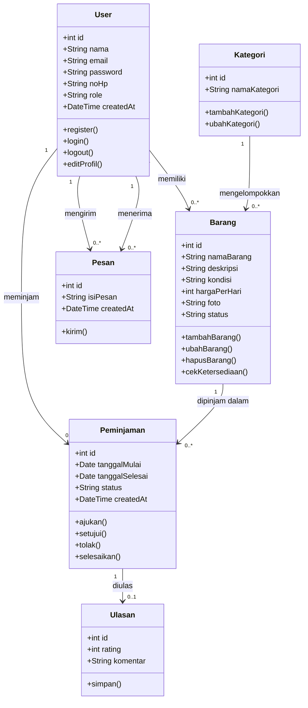

# 🧱 Class Diagram PinjamKuy

**Tujuan:** memahami struktur statis dan relationship antar-entity. Class diagram menunjukkan kelas-kelas dalam sistem, atribut dan fungsinya, serta hubungan antar kelas. Kelas-kelas ini sejalan dengan tabel di [ERD](../sprint-1/erd.md).

## Diagram

## Penjelasan Relasi

| Relasi | Arti |
|--------|------|
| User 1 ke banyak Barang | Satu pengguna bisa memiliki banyak barang |
| Kategori 1 ke banyak Barang | Satu kategori berisi banyak barang |
| User 1 ke banyak Peminjaman | Satu pengguna bisa melakukan banyak peminjaman |
| Barang 1 ke banyak Peminjaman | Satu barang bisa dipinjam berkali-kali di waktu berbeda |
| Peminjaman 1 ke 0 atau 1 Ulasan | Satu peminjaman punya paling banyak satu ulasan |
| User 1 ke banyak Pesan | Satu pengguna bisa mengirim dan menerima banyak pesan |

## Keterangan Simbol

| Simbol | Arti |
|--------|------|
| `+` | Atribut atau fungsi bersifat public |
| `1` | Tepat satu |
| `0..*` | Nol atau lebih |
| `0..1` | Nol atau satu |
