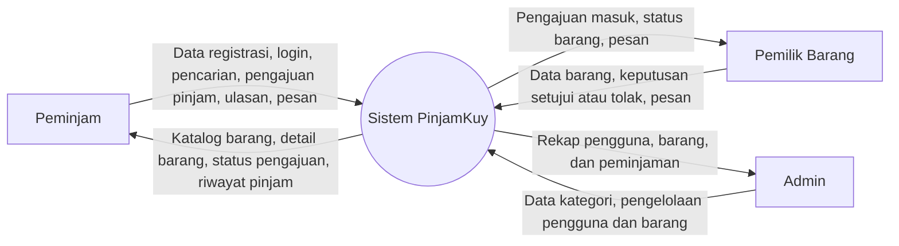

# 🌐 Context Diagram PinjamKuy

**Tujuan:** memahami scope dan lingkungan sistem. Context diagram menampilkan sistem sebagai satu kesatuan (satu lingkaran), lalu menunjukkan siapa saja pihak luar yang berhubungan dengannya dan data apa yang mengalir.

## Diagram

## Entitas Eksternal

| Entitas | Peran terhadap sistem |
|---------|-----------------------|
| Peminjam | Mencari barang, mengajukan pinjam, memberi ulasan |
| Pemilik Barang | Memasang barang, menyetujui atau menolak pengajuan |
| Admin | Mengelola pengguna, kategori, dan memantau transaksi |

## Batas Sistem (Scope)

**Termasuk dalam sistem:** registrasi dan login, katalog dan pencarian barang, pengelolaan barang, pengajuan dan persetujuan peminjaman, chat, ulasan, dan riwayat.

**Di luar sistem:** pembayaran online, pengiriman barang, dan verifikasi identitas oleh pihak ketiga. Serah terima barang dilakukan langsung antara pemilik dan peminjam.
