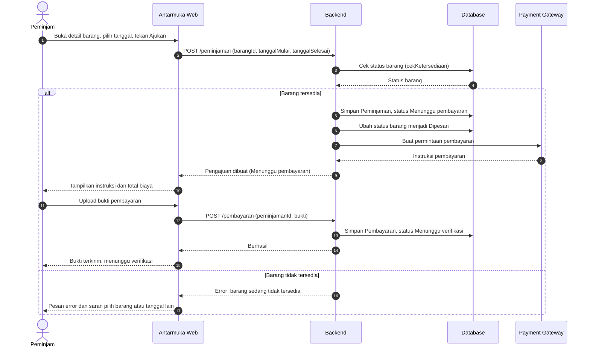
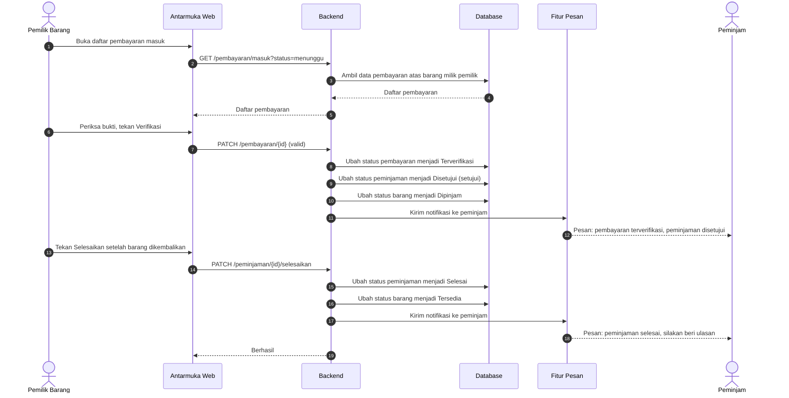
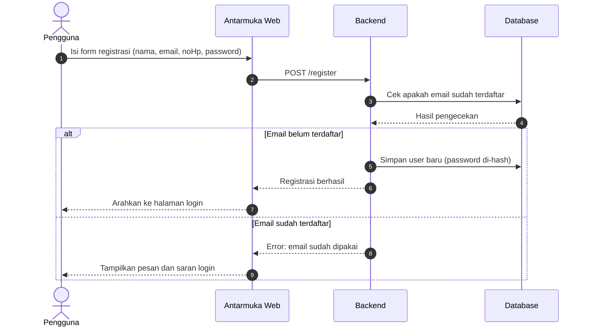
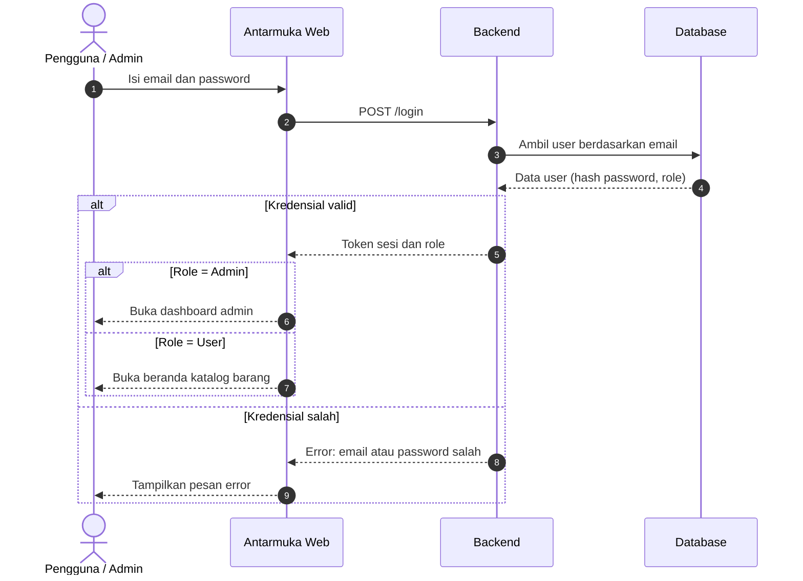
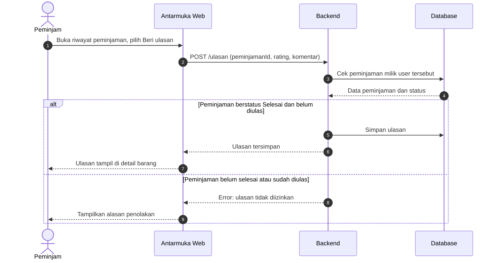

# Sequence Diagram — PinjamKuy

Sequence diagram menggambarkan **urutan pesan antar peserta** dalam satu skenario, dibaca dari atas ke bawah. Nomor pada tiap panah (autonumber) menunjukkan urutan kejadian. Panah penuh adalah permintaan, panah putus-putus adalah balasan, dan kotak `alt` adalah percabangan kondisi.

> Seluruh peserta, data, dan fungsi mengacu pada [Class Diagram PinjamKuy](class-diagram.md): `User`, `Kategori`, `Barang`, `Peminjaman`, `Pesan`, dan `Ulasan`, ditambah kelas `Pembayaran` yang perlu dimasukkan ke class diagram (relasi: `Peminjaman` 1 ke 0..* `Pembayaran`).

### 3.1 Skenario A: Peminjaman dan Pembayaran oleh Peminjam

### 3.2 Skenario B: Verifikasi Pembayaran dan Penyelesaian Peminjaman oleh Pemilik Barang

### 3.3 Skenario C: Registrasi Pengguna

### 3.4 Skenario D: Login (Pengguna dan Admin)

### 3.5 Skenario E: Beri Ulasan

