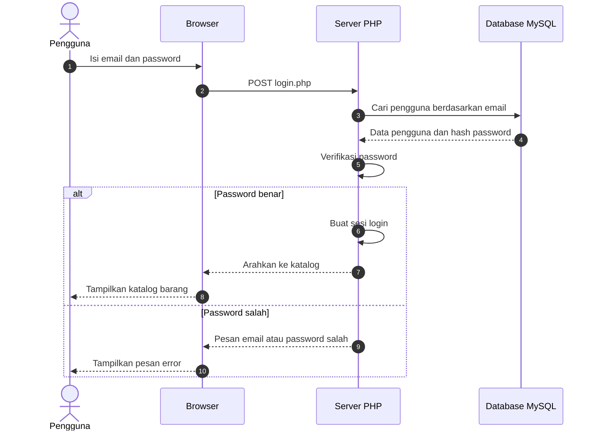
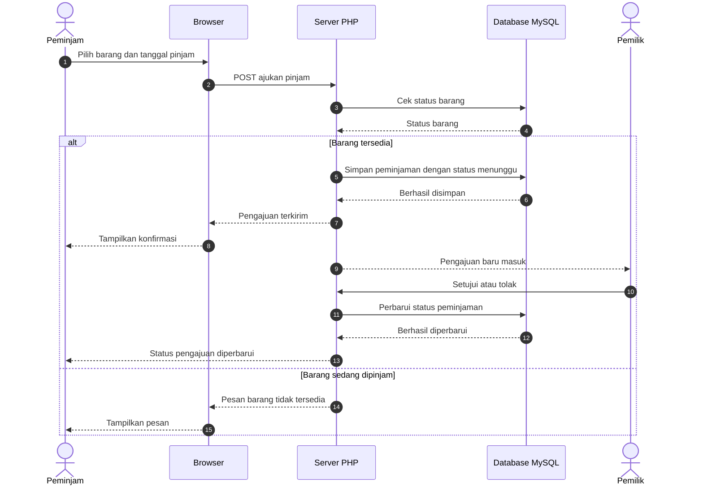
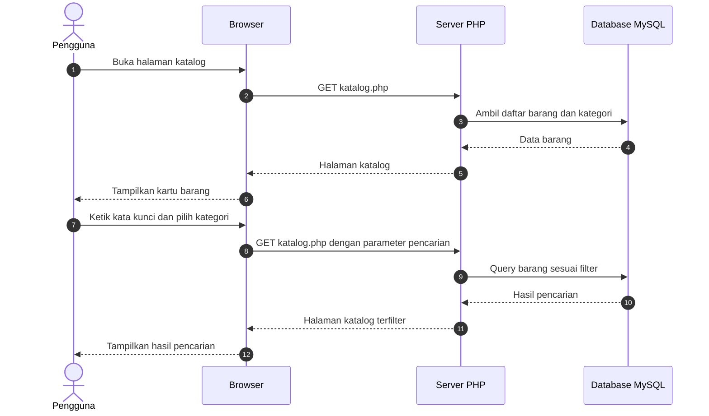

# 🔁 Sequence Diagram PinjamKuy

**Tujuan:** memahami urutan komunikasi dalam suatu skenario. Sequence diagram menunjukkan siapa mengirim pesan ke siapa, dan dalam urutan apa.

## 1. Skenario Login

## 2. Skenario Pengajuan Peminjaman

## 3. Skenario Melihat Katalog dan Mencari Barang

