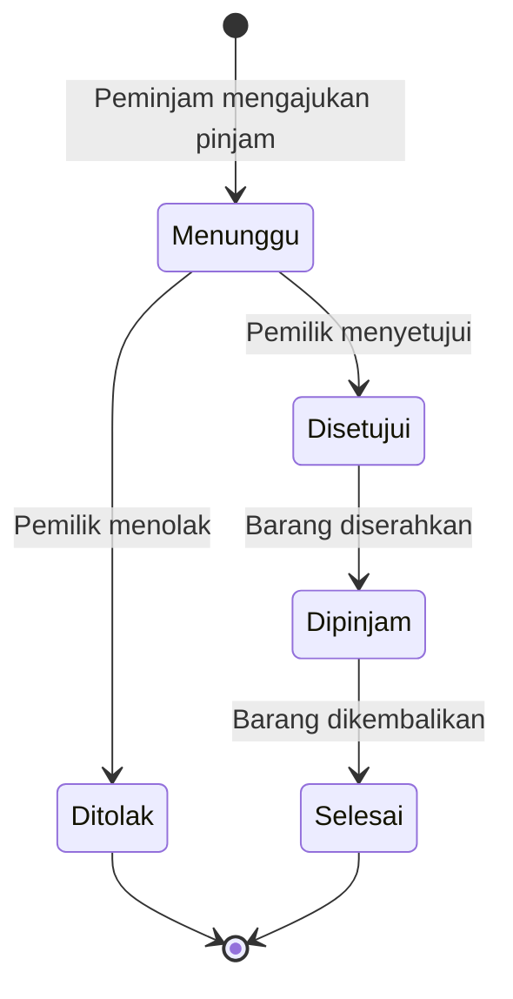
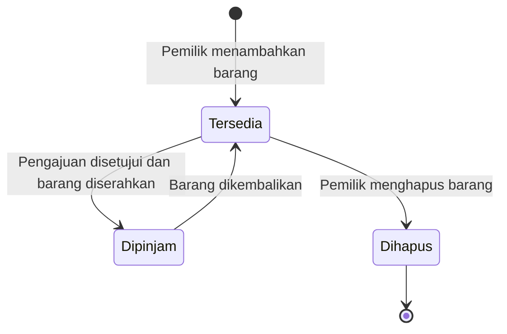
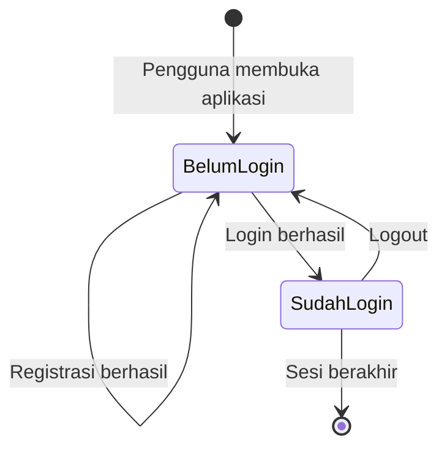

# 🔄 State Diagram PinjamKuy

**Tujuan:** memahami perubahan perilaku sebagai respons terhadap event. State diagram menunjukkan keadaan (state) suatu objek dan peristiwa (event) yang membuatnya berpindah keadaan.

## 1. State Peminjaman

Status ini sama dengan kolom `status` di tabel `loans`.

## 2. State Barang

Status ini sama dengan kolom `status` di tabel `items`.

## 3. State Sesi Pengguna

## Keterangan

| State | Arti |
|-------|------|
| Menunggu | Pengajuan sudah dikirim, belum ada keputusan pemilik |
| Disetujui | Pemilik setuju, barang belum diserahkan |
| Ditolak | Pemilik menolak pengajuan |
| Dipinjam | Barang sedang dipakai peminjam |
| Selesai | Barang sudah kembali, peminjaman tuntas |
