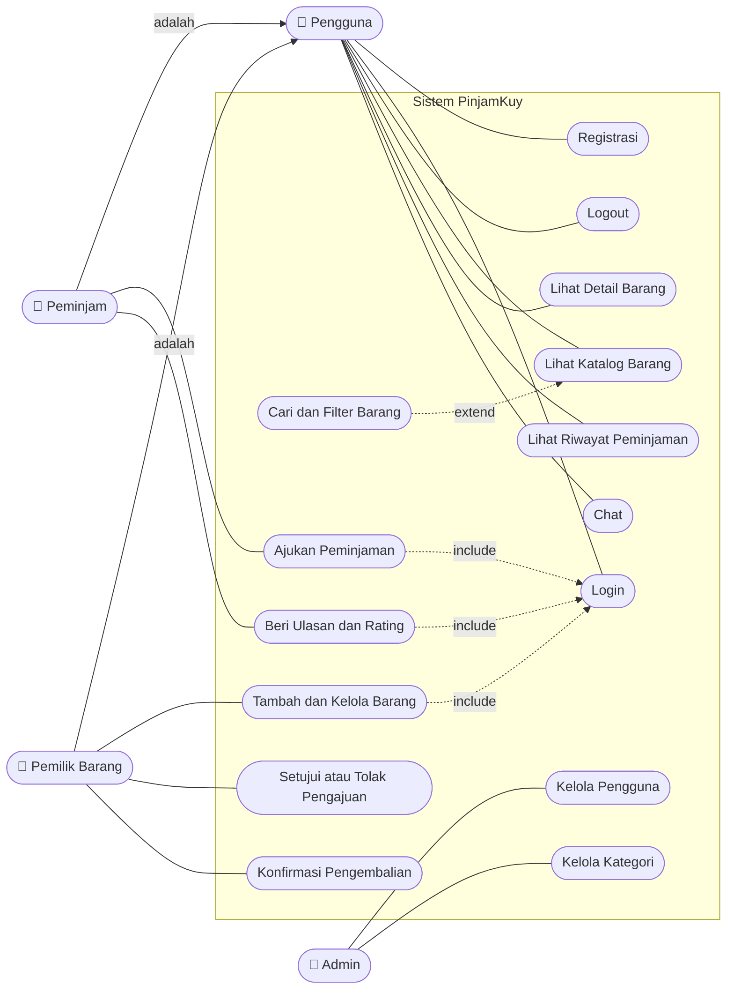

# 🎯 Use Case Diagram PinjamKuy

**Tujuan:** memahami tujuan dan interaksi aktor dengan sistem. Use case diagram menunjukkan apa saja yang bisa dilakukan tiap aktor terhadap sistem.

## Diagram

> Mermaid tidak punya diagram use case bawaan, jadi aktor dan use case digambar dengan flowchart. Garis lurus adalah hubungan aktor dengan use case, garis putus-putus adalah relasi `include` dan `extend`.

## Daftar Aktor

| Aktor | Keterangan |
|-------|------------|
| Pengguna | Aktor umum, semua pengguna yang sudah punya akun |
| Peminjam | Pengguna yang meminjam barang |
| Pemilik Barang | Pengguna yang memasang barang untuk dipinjamkan |
| Admin | Pengelola sistem |

## Deskripsi Use Case Utama

### UC-02 Login

| Bagian | Isi |
|--------|-----|
| Aktor | Pengguna |
| Prakondisi | Pengguna sudah punya akun |
| Alur utama | 1. Pengguna membuka halaman login. 2. Mengisi email dan password. 3. Sistem memeriksa data. 4. Sistem membuka halaman katalog. |
| Alur alternatif | Data salah: sistem menampilkan pesan error dan pengguna mengisi ulang. |
| Pascakondisi | Pengguna masuk dan sesi tersimpan |

### UC-07 Ajukan Peminjaman

| Bagian | Isi |
|--------|-----|
| Aktor | Peminjam |
| Prakondisi | Peminjam sudah login dan barang berstatus tersedia |
| Alur utama | 1. Peminjam membuka detail barang. 2. Memilih tanggal mulai dan selesai. 3. Menekan tombol ajukan. 4. Sistem menyimpan pengajuan dengan status menunggu. 5. Pemilik menerima pengajuan. |
| Alur alternatif | Barang sedang dipinjam: sistem menolak pengajuan dan menampilkan pesan. |
| Pascakondisi | Pengajuan tersimpan dengan status menunggu |

### UC-11 Setujui atau Tolak Pengajuan

| Bagian | Isi |
|--------|-----|
| Aktor | Pemilik Barang |
| Prakondisi | Ada pengajuan berstatus menunggu |
| Alur utama | 1. Pemilik membuka daftar pengajuan. 2. Memilih pengajuan. 3. Menekan setujui atau tolak. 4. Sistem memperbarui status. |
| Pascakondisi | Status pengajuan menjadi disetujui atau ditolak |
